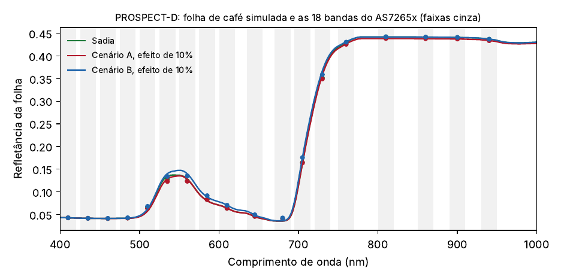
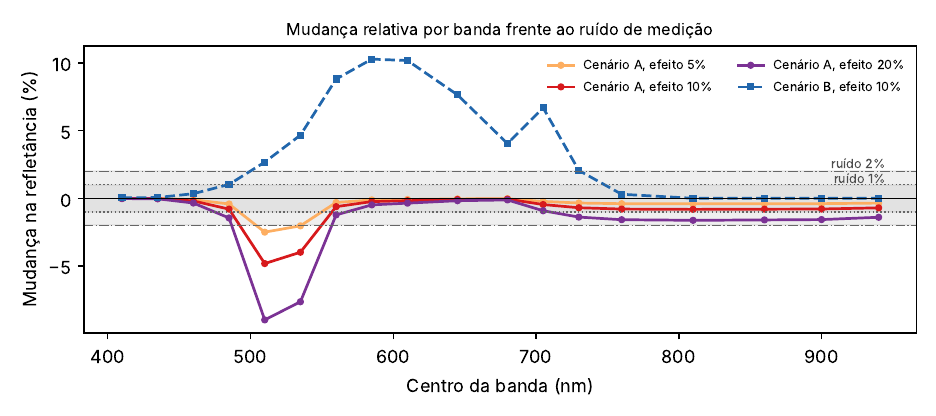
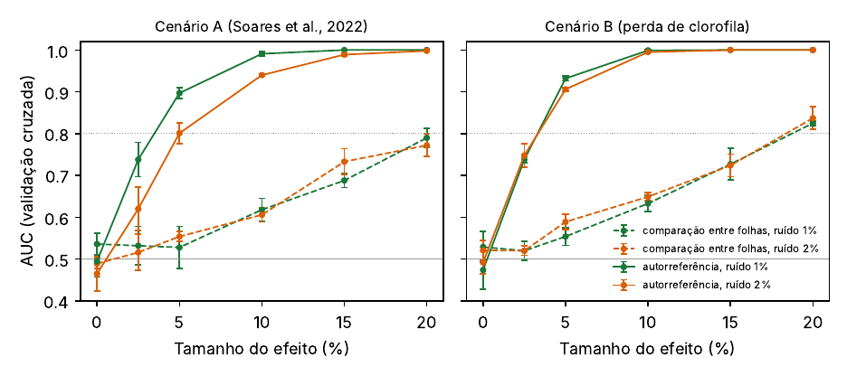
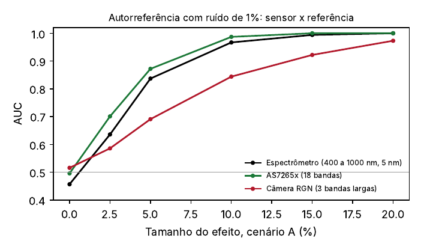
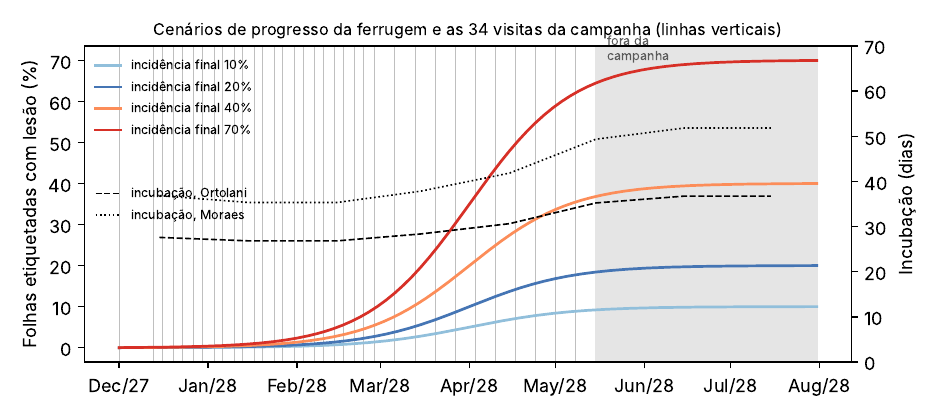
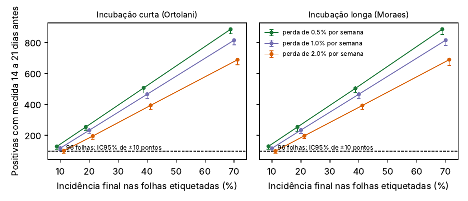
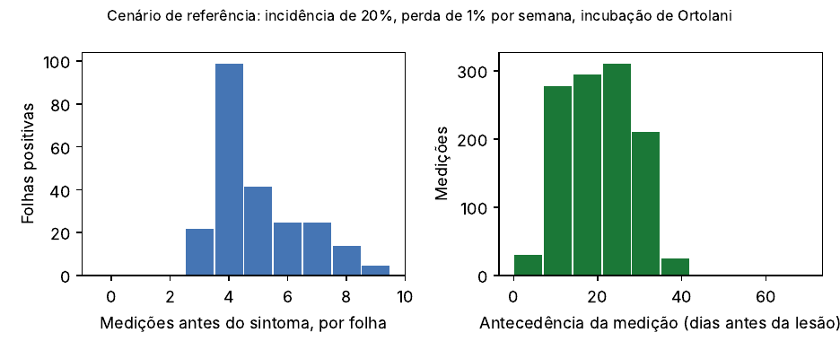
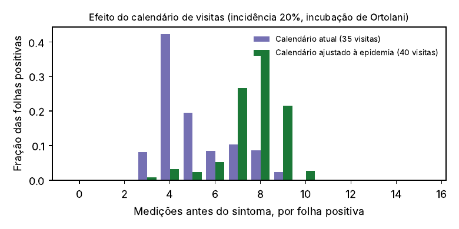

<p align="center">
  
</p>

<h1 align="center">SPECULA · RT-01</h1>
<p align="center"><b>Vigilância da saúde do cafeeiro: prova de conceito por simulação</b></p>

<p align="center">
  
  
  
  
  
</p>

> [!IMPORTANT]
> **Versão beta (0.1).** Este repositório contém **simulações**, não experimentos. Nenhum instrumento foi montado e nenhuma folha foi medida até agora. O estágio da solução é **Ideia**. As simulações foram feitas para testar, antes de gastar recurso, se o sensor escolhido tem chance de enxergar o fenômeno e se a coleta de campo planejada produz dados suficientes. Todas as hipóteses estão declaradas e todos os números podem ser reproduzidos com o código deste repositório.

---

## O que é o SPECULA

O SPECULA é um projeto de vigilância da saúde do cafeeiro para antecipar a **ferrugem do café** (*Hemileia vastatrix*), principal doença do café arábica. A doença só fica visível de 28 a 65 dias depois da infecção. O projeto une três partes:

| Módulo | Função |
|---|---|
| **SPECULA Scan** | Leitor portátil de refletância no visível e no infravermelho próximo (sensor AS7265x, 18 bandas), com IA embarcada e uso sem internet. |
| **SPECULA Sentinel** | Nós fixos com energia solar em cafeeiros sentinela, medindo a mesma folha todos os dias, mais microclima (temperatura, umidade e molhamento foliar). |
| **SPECULA Cloud** | Plataforma que cruza o sinal da planta com o risco climático e transforma alertas em tarefas de inspeção para o técnico. |

O projeto foi aprovado na Fase 1 do **Programa Centelha 3 Paraná** e este repositório acompanha a proposta da Fase 2.

## As duas perguntas deste relatório

1. **O sensor enxerga?** Um sensor de baixo custo com 18 bandas de 20 nm distingue as alterações que a literatura descreve nas primeiras semanas da infecção, considerando o ruído e a variação natural entre folhas?
2. **A coleta gera dados suficientes?** A coorte de 1.500 folhas etiquetadas, com o calendário de visitas do projeto, produz folhas doentes e medições anteriores ao sintoma em quantidade suficiente?

📄 **Relatório completo:** [`relatorio_RT01.pdf`](relatorio_RT01.pdf) (9 páginas, com métodos, resultados, limitações e referências).

---

## Simulação 1: detectabilidade óptica

Folhas de café simuladas com o **PROSPECT-D** (Féret et al., 2017) e medidas por um modelo do **AS7265x** (18 bandas, largura a meia altura de 20 nm). As alterações seguem as direções observadas por Soares et al. (2022) aos 15 dias após a inoculação, ainda sem sintoma: mais carotenoides e matéria seca, menos água.

<p align="center"></p>
<p align="center"></p>

**O resultado mais importante:** comparar uma folha com *outras* folhas sadias quase não funciona, porque a variação natural entre folhas esconde o sinal. Comparar a folha com *ela mesma* em visitas anteriores (autorreferência) torna a alteração detectável.

<p align="center"></p>

| Tamanho do efeito | Entre folhas (AUC) | Autorreferência (AUC) |
|---|---|---|
| 2,5% | 0,53 | 0,74 |
| 5% | 0,53 | 0,90 |
| 10% | 0,62 | 0,99 |
| 20% | 0,79 | 1,00 |

*Cenário A, ruído de 1%, média de 3 repetições com validação cruzada de 5 partes.*

<p align="center"></p>

Com autorreferência, o AS7265x tem desempenho equivalente ao de um espectrômetro de referência e superior ao de uma câmera de três bandas largas, porque a assinatura do cenário A está entre 510 e 535 nm. Os três sensores usam o mesmo classificador linear, então a diferença vem só das bandas. Os 80% de acerto de Soares et al. (2022) vêm de outro classificador (SVM) e de outro desenho, e não são diretamente comparáveis a estes valores.

---

## Simulação 2: suficiência da coorte de campo

Monte Carlo (300 realizações por cenário) da coorte de **1.500 folhas** do 3º e 4º par do terço médio, etiquetadas em Cambira (PR). O período de incubação é calculado mês a mês pelo clima de Apucarana, com as equações de Ortolani et al. (1971) e Moraes et al. (1976), revisadas por Alfonsi et al. (2019). O progresso da doença é ancorado em dados de campo publicados de Varginha e do sul de Minas Gerais.

<p align="center"></p>
<p align="center"></p>

| Incidência final | Positivas detectadas | Medições pré-sintoma por folha (mediana) | Chance de ≥ 96 positivas* |
|---|---|---|---|
| 10% | 116 | 4 a 6 | 100% (66% com perda de 2%/semana) |
| 20% | 232 | 4 a 6 | 100% |
| 40% | 466 | 4 a 6 | 100% |
| 70% | 816 | 4 a 6 | 100% |

*\*96 folhas positivas com medição de 14 a 21 dias antes da lesão dão intervalo de confiança de 95% de ±10 pontos para a sensibilidade. Perda de folhas de 1% por semana, salvo indicação.*

<p align="center"></p>

**A simulação encontrou uma falha no próprio plano:** as lesões aparecem sobretudo entre março e maio, mas o calendário original concentrava as visitas em dezembro a fevereiro. Um calendário ajustado à epidemia, com só 4 visitas a mais, dobra as medições antes do sintoma (mediana de 4 para 8). Os cenários da tabela acima usam o calendário original (34 visitas mais a etiquetagem), que é o caso conservador.

<p align="center"></p>

## Decisões de projeto que saem das simulações

- Medir a mesma folha repetidas vezes (coorte e Sentinel) é a base do método.
- O AS7265x é suficiente para o Scan; câmeras de três bandas não servem como fonte espectral.
- O calendário de campo passa a ser semanal do fim da etiquetagem até janeiro e de duas visitas por semana de 01/02 a 15/05/2028 (38 visitas mais a etiquetagem, cerca de 58,5 mil medições). **Já adotado no cronograma do projeto.**
- O Marco 3 do projeto passa para 31/03/2028, com pelo menos 60 folhas com lesão. **Já adotado no cronograma do projeto.**
- A incidência mínima de 10% é garantida com uma faixa de manejo reduzido de fungicida, e a perda de folhas deve ficar em até 1% por semana.

## Limitações

- As magnitudes das alterações aos 15 dias não foram publicadas; por isso os efeitos foram varridos de 0 a 20%.
- Os valores de clorofila, carotenoides, água e matéria seca da folha sadia são hipóteses, a substituir por medições na bancada.
- A curva de progresso foi ancorada em calendário e picos publicados, não ajustada a dados de Cambira.
- Outras doenças e estresses que imitam a ferrugem não foram simulados.

---

## Estrutura do repositório

```
specula-rt01/
├── README.md                     este arquivo
├── relatorio_RT01.pdf            relatório técnico completo
├── relatorio_RT01.tex            fonte LaTeX do relatório
├── gen_tex.py                    escreve o .tex lendo os números dos arquivos JSON
├── exportar_dados.py             exporta entradas e resultados para CSV (pasta dados/)
├── requirements.txt              dependências Python com versões travadas
├── resultados_optica.json        resultados completos da simulação 1
├── resultados_coorte.json        resultados completos da simulação 2
├── sim/
│   ├── sim_optica.py             simulação 1: PROSPECT-D + AS7265x
│   └── sim_coorte.py             simulação 2: Monte Carlo da coorte
├── fig/                          figuras em PDF (vetorial) e PNG
├── dados/                        todas as entradas e saídas numéricas em CSV
└── assets/logo.png
```

## Dados (pasta `dados/`)

| Arquivo | Tipo | Conteúdo |
|---|---|---|
| `as7265x_canais.csv` | entrada | centros e largura das 18 bandas do sensor |
| `folha_parametros_prospect.csv` | entrada | parâmetros da folha, variação natural e origem de cada valor |
| `clima_apucarana_climatempo.csv` | entrada | temperaturas mínima e máxima e chuva mensais |
| `incubacao_por_mes.csv` | entrada | período de incubação mês a mês pelas duas equações |
| `ancoras_epidemiologicas.csv` | entrada | dados de campo publicados usados para ancorar a epidemia |
| `espectros_prospectd_400_1000nm.csv` | saída | espectros simulados da folha sadia e alterada |
| `resultado_mudanca_por_banda.csv` | saída | mudança percentual em cada banda do sensor |
| `resultado_auc_curvas.csv` | saída | AUC por modo, ruído, cenário e tamanho do efeito |
| `resultado_auc_sensores.csv` | saída | AUC do espectrômetro, do AS7265x e da câmera de 3 bandas |
| `resultado_coorte_cenarios.csv` | saída | positivas, medições pré-sintoma e probabilidades por cenário |
| `resultado_calendarios.csv` | saída | comparação entre o calendário original e o ajustado |

## Como reproduzir

```bash
pip install -r requirements.txt
cd sim
python sim_optica.py        # figuras 1 a 4 e resultados_optica.json (cerca de 4 minutos)
python sim_coorte.py        # figuras 5 a 8 e resultados_coorte.json (cerca de 1 minuto)
cd ..
python exportar_dados.py    # tabelas CSV na pasta dados/
python gen_tex.py           # relatorio_RT01.tex com os números dos JSON
pdflatex relatorio_RT01.tex
```

Sementes fixas: `20261111` (óptica) e `20261112` (coorte).

## Referências principais

- Féret, J.-B.; Gitelson, A. A.; Noble, S. D.; Jacquemoud, S. PROSPECT-D. *Remote Sensing of Environment*, 193, 204-215, 2017. [doi:10.1016/j.rse.2017.03.004](https://doi.org/10.1016/j.rse.2017.03.004)
- Soares, A. S. et al. Early detection of coffee leaf rust caused by *Hemileia vastatrix* using multispectral images. *Agronomy*, 12(12), 2911, 2022. [doi:10.3390/agronomy12122911](https://doi.org/10.3390/agronomy12122911)
- Alfonsi, W. M. V. et al. Período de incubação da ferrugem do cafeeiro. *Summa Phytopathologica*, 45(2), 134-140, 2019. [doi:10.1590/0100-5405/187216](https://doi.org/10.1590/0100-5405/187216)
- Honorato Júnior, J. et al. *Journal of Phytopathology*, 163(11-12), 968-977, 2015. [doi:10.1111/jph.12399](https://doi.org/10.1111/jph.12399)
- Besozzi, A. et al. *Acta IMEKO*, 15(2), 1-12, 2026. [doi:10.21014/actaimeko.v15i2.2267](https://doi.org/10.21014/actaimeko.v15i2.2267)
- Japiassú, L. B. et al. Simpósio de Pesquisa dos Cafés do Brasil, 4., Londrina, 2005.
- Meira, C. A. A.; Rodrigues, L. H. A. Simpósio de Pesquisa dos Cafés do Brasil, 6., Vitória, 2009.
- Lopes, P. R. et al. *Revista Brasileira de Agroecologia*, 7(1), 160-168, 2012.
- ams OSRAM. *AS7265x Datasheet*.

A lista completa está no relatório.

---

## Autor

<table>
<tr>
<td width="140" align="center"></td>
<td>

**Dr. Anuar José Mincache**
Doutor em Física pela Universidade Estadual de Maringá (UEM) e pós-doutor pela Lund University (Suécia). Especialista em Ciência de Dados e graduado em Análise e Desenvolvimento de Sistemas. Coordenador do Grupo de Pesquisa CNPq Centro de Inovação em Automação e Inteligência Artificial Curie-Turing. Publicações em visão computacional para agricultura de precisão, com detecção de pragas por aprendizado profundo em lavouras reais e monitoramento da saúde da vegetação com NDVI e redes neurais convolucionais.

[ORCID 0000-0001-8528-8020](https://orcid.org/0000-0001-8528-8020) · [Currículo Lattes](http://lattes.cnpq.br/9526608938362113) · [LinkedIn](https://www.linkedin.com/in/anuar-mincache/) · [GitHub](https://github.com/anuarmincache)

</td>
</tr>
</table>

## Como citar

> MINCACHE, A. J. *SPECULA RT-01: prova de conceito por simulação. Detectabilidade óptica e suficiência do desenho de coleta*. Versão 0.1 beta. Maringá, 2026. Disponível em: https://github.com/anuarmincache/specula-rt01

---

<sub>Versão 0.1 beta, novembro de 2026. Projeto em desenvolvimento no âmbito do Programa Centelha 3 Paraná. Os resultados são de simulação e serão substituídos por medições reais à medida que o projeto avançar.</sub>
